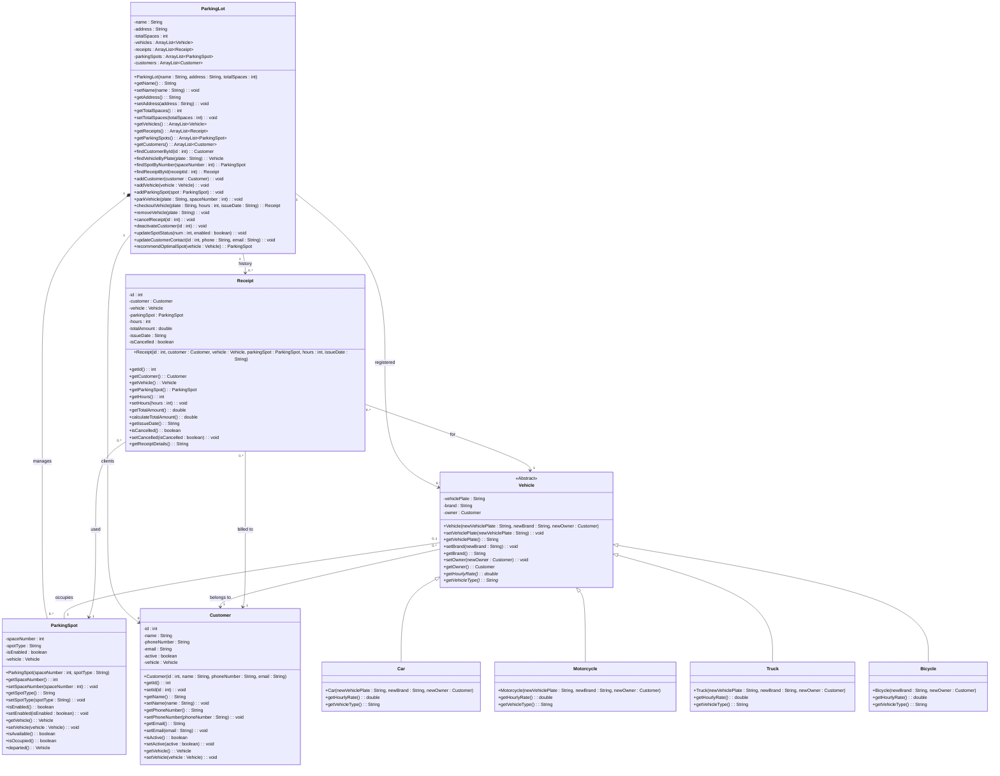

# Smart Parking System
**Proyecto Final — Programación Orientada a Objetos (Java 25 LTS)**

**Integrantes:** 
* Alejandro Ocampo Escobar (Código: 75145)
* Joshua Franco (Código: 75283)

---

## Descripción General
Sistema de gestión interna diseñado para el personal operativo y administrativo de un parqueadero inteligente. Permite administrar clientes, registrar y clasificar distintos tipos de vehículos (Carros, Motos, Camiones y Bicicletas), asignar espacios de parqueo dinámicamente, calcular tarifas mediante polimorfismo y emitir un historial inmutable de recibos. Incluye persistencia binaria mediante serialización de objetos, exportación de reportes a archivos `.csv` y un módulo de apoyo a decisiones para recomendación de espacios y análisis de ocupación.

---

## Arquitectura del Proyecto
```text
POO_FinalProject_Ocampo_Franco/
├── src/
│   ├── ui/         # Interfaz de usuario por consola (menús e interacción)
│   ├── domain/     # Entidades del modelo, reglas de negocio y lógica de decisión
│   └── data/       # Persistencia serializada (.dat/.ser) y exportación a CSV
└── README.md
```

---

## Instrucciones de Ejecución
1. Verificar que **Java 25 LTS (OpenJDK 25)** esté instalado (`java -version`).
2. Abrir una terminal en la raíz del repositorio y compilar el código fuente:
   ```bash
   javac -d bin src/domain/*.java src/data/*.java src/ui/*.java
   ```
3. Ejecutar la aplicación desde la clase principal:
   ```bash
   java -cp bin ui.MainConsole
   ```
   *(También puede ejecutarse directamente abriendo el proyecto en Visual Studio Code y corriendo `MainConsole.java`).*

---

## Diagrama de Clases del Dominio


