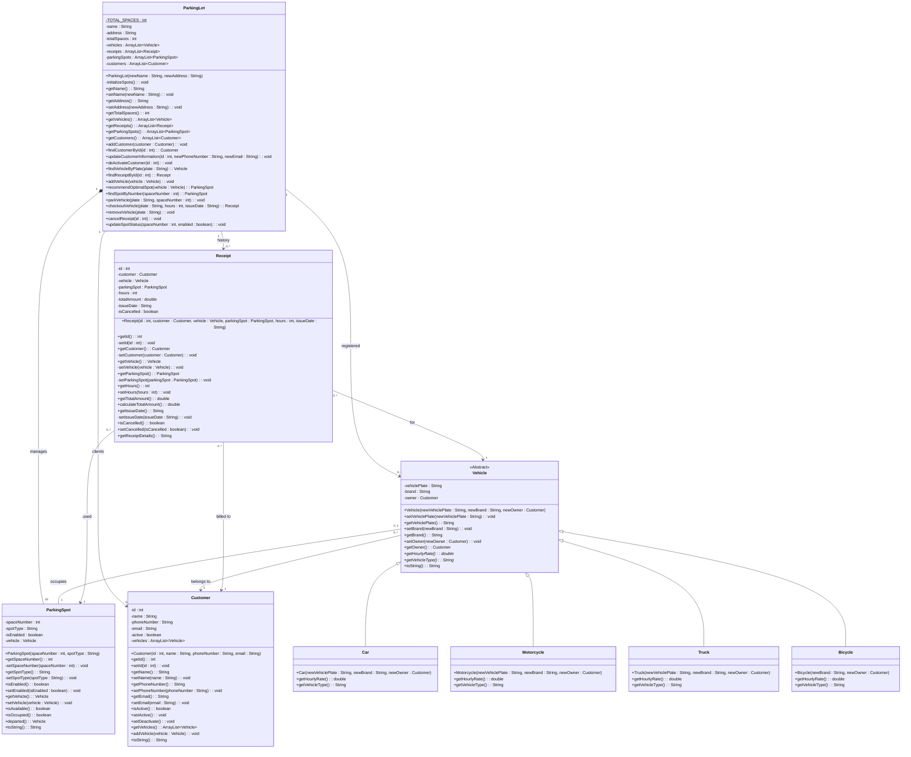

# Smart Parking System
**Proyecto Final — Programación Orientada a Objetos**

**Integrantes:**
- Alejandro Ocampo Escobar (Código: 75145)
- Joshua Franco (Código: 75283)

---

## Descripción General
**Smart Parking System** es una aplicación de consola diseñada para facilitar la administración diaria de un parqueadero con capacidad fija de 22 espacios. El sistema centraliza el registro de clientes y vehículos, organiza la ocupación de los espacios según el tipo de vehículo, calcula automáticamente el valor a cobrar por horas de estadía y conserva un historial de recibos junto con el respaldo de toda la información.

---

## ¿Qué puede hacer el sistema?
- **Gestión de clientes:** Registrar nuevos clientes, consultarlos por su identificación, actualizar sus datos de contacto y desactivarlos sin borrar su historial.
- **Registro de vehículos:** Asociar carros, motos, camiones y bicicletas a cada cliente, aplicando tarifas por hora diferentes según el tipo de vehículo.
- **Control de espacios:** Administrar los 22 espacios del parqueadero, verificar cuáles están disponibles, ocupados o deshabilitados, y asegurar que cada vehículo ocupe un espacio compatible.
- **Ingreso y salida con facturación:** Registrar la entrada de un vehículo, calcular el valor total al salir según las horas de estadía y emitir un recibo detallado.
- **Historial de recibos:** Consultar los comprobantes generados y anularlos en caso de error sin eliminar el registro.
- **Recomendación de espacios:** Sugerir un espacio disponible adecuado para el vehículo que ingresa.
- **Guardado de información y reportes:** Guardar y recuperar los datos del parqueadero entre sesiones y exportar la información en archivos CSV.

---

## Estructura y Clases del Proyecto

El proyecto está organizado en tres partes principales:
- **Lógica del parqueadero (`domain`):** Contiene las entidades del sistema y las reglas de funcionamiento.
- **Manejo de archivos (`data`):** Se encarga de guardar y cargar la información del parqueadero y generar reportes.
- **Interfaz de consola (`ui`):** Muestra los menús y permite al operador interactuar con el sistema.

Las clases principales que conforman el modelo del parqueadero son:
- **`ParkingLot`:** Es la clase central que representa el parqueadero (22 espacios) y coordina las listas de clientes, vehículos, espacios y recibos.
- **`ParkingSpot`:** Representa cada espacio individual del parqueadero, indicando su número, el tipo de vehículo que acepta y si está disponible, ocupado o deshabilitado.
- **`Customer`:** Almacena los datos personales del cliente, su estado (activo o inactivo) y los vehículos registrados a su nombre.
- **`Vehicle`:** Define los datos comunes de cualquier vehículo (placa, marca y propietario) y establece el comportamiento general para calcular tarifas.
- **`Car`, `Motorcycle`, `Truck` y `Bicycle`:** Representan cada tipo de vehículo que atiende el parqueadero, cada uno con su propia tarifa por hora.
- **`Receipt`:** Representa el comprobante generado al finalizar una estadía, guardando el cliente, el vehículo, el espacio utilizado, las horas, la fecha, el total a pagar y si fue anulado.

---
## Diagrama de Clases del Dominio

