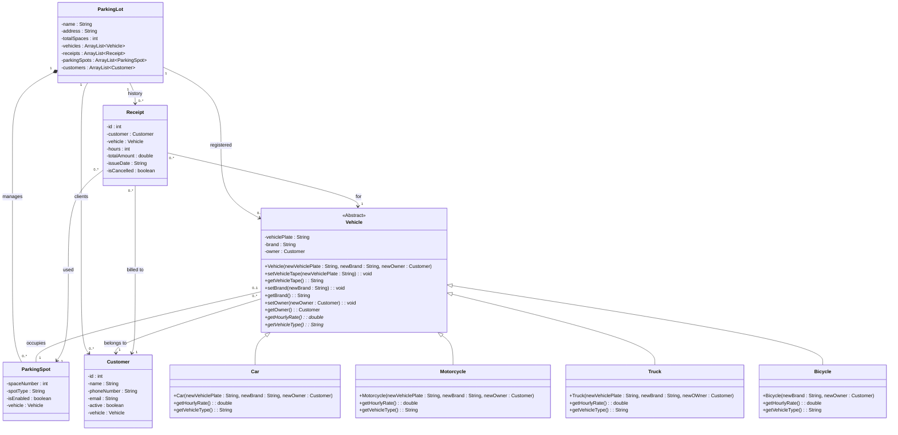

# Smart Parking System
**Proyecto Final — Programación Orientada a Objetos**

**Integrantes:** 
* Alejandro Ocampo Escobar (Código: 75145)
* Joshua Franco (Código: 75283)

## Descripción General
Sistema de gestión interna para un parqueadero inteligente. Permite registrar clientes, controlar la entrada y salida de distintos tipos de vehículos (Carros, Motos, Camiones, Bicicletas), asignar espacios de parqueo dinámicamente y facturar el tiempo de estadía generando un historial inmutable de recibos. Incluye persistencia de datos y exportación a CSV.

## Instrucciones de Ejecución
1. Asegurarse de tener instalado Java 25 LTS (OpenJDK 25).
2. Compilar los archivos desde la carpeta `src`.
3. Ejecutar la clase principal ubicada en `ui.MainConsole`.

## Diagrama de Clases del Dominio

